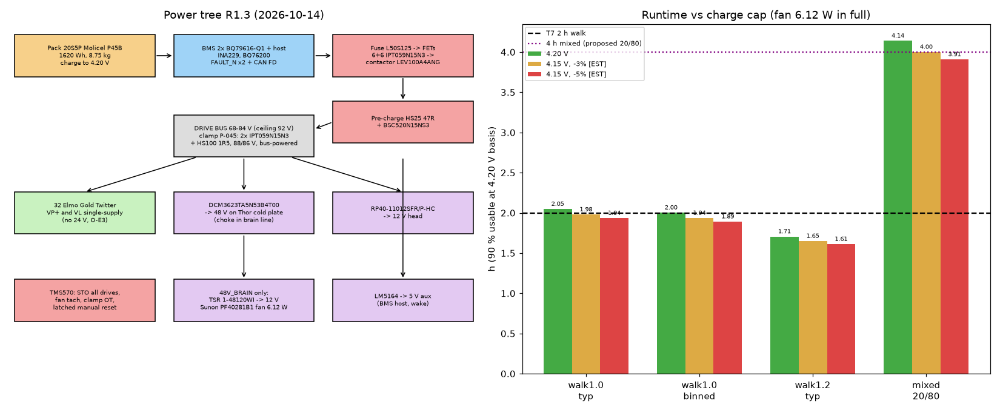

# RL Torso & Power — R1 architecture (2026-10-14)
Owner: RL Torso & Power (067740e6). Check script: `r1_torso.py` → `r1_torso.json`, figure `R1_torso_power.png`.
Scope: pelvis, torso frame, waist joints (selection by RL Actuators), battery pack, BMS, power distribution/protection, runtime.
Basis: CONTRACTS R1.1/R1.3/R1.4/§1a/§1c/§3, official rollup (R-027), `actuators/results/sizing.md`, `arms/R1_ARCHITECTURE.md`, `electronics/R1_ARCHITECTURE.md` (1e33c96). [EST] = estimate, ×0.5 evidence.

## 1. Chassis structure
- **Torso:** CFRP 2.0 mm monocoque shell (v3 used 3 mm; 2 mm proposed with local inserts) carrying a machined 7075 **shoulder bulkhead** (two 8 × M8 12.9 shoulder mounts, CONTRACTS §1c) and a 7075 **waist ring** bolted to the waist_pitch output. Pack slides into rails in the lower chest from the back (swappable, T7), latch + 2 guide pins + blind-mate connector.
- **Pelvis:** machined 7075 box: waist_yaw housing on top, 2 × hip bracket 8 × M5 12.9 below (§1c, hip y ±130 mm), hip_pitch twin-screw trunnion brackets (out of Legs scope, P-007 note) on the front/back walls.
- **Load paths:** arms → shoulder bulkhead → shell → waist ring → waist_pitch → waist_yaw → pelvis → hip brackets → legs. Pack mass goes rails → shell bottom flange → waist ring (not through the shell skin). Fall loads (T8): shoulder side impact into bulkhead (300 N·m shoulder_roll clutch caps arm moment); torso/pelvis shells are outer skin (no covers, R-021).
- **Mass (paper, all [EST] until CAD):** shell 1.705 + bulkhead 0.45 + waist ring 0.25 + pack rails/latch 0.20 + pelvis 1.45 + power distribution (busbars, branch fuses, 5 V aux, PCB) 0.25 = **4.305 kg** vs v3 allocation pelvis 1.6 + torso 2.8 = 4.40 kg (−0.095). No FEA this round.

## 2. Waist joints (DOF 2: yaw + pitch, T3 unchanged)
| joint | v3 / contract need | R1 load case (static, [EST] geometry) | need 1.5× | v3 selection avail | status |
|---|---|---|---|---|---|
| waist_yaw | 60 N·m, 2 rad/s | turning/arm reaction, not simulated | 60 (keep) | TBM2G-06008A + CSG-17-100, 70 | OK, keep |
| waist_pitch | 115.4 N·m, 2 rad/s | 10 kg at full reach, lean 30°: **125.5**; 20 kg carry lean 15°: 112.8 | **188** | TBM2G-06808A + CSG-25-100, **116** | **FAILS** |
Model: sim torso 18.762 kg @ 0.169 m (`humanoid_v3.xml`), catalog arms 9.54 kg/side (arms R1), shoulder 0.30 m above axis, payload 0.30 m (waist carry) / 0.60 m (reach). The v3 115.4 need had no payload case (T5 was not checked in v3).
Proposal to RL Actuators (to file as P-0xx): waist_pitch motor → **TBM2G-08508A** on the same CSG-25-100 (= hip_roll selection, 204 N·m avail, 1.56 vs 1.37 kg, **+0.19 kg**). Alternative: lower the T5 reach case lean to ≤ 15° (Controls/Arbiter call).

## 3. Battery pack (per CONTRACTS R1.3, R-010 — unchanged)
- Cell **Molicel INR-21700-P45B** (4.5 Ah typ, 3.6 V, 16.2 Wh, ≤ 70 g, 45 A cont; datasheet in `v3/PARTS.md`), screened ≥ 4400 mAh at 0.2C.
- **20S5P, 100 cells: 68.0 / 72.0 / 84.0 V (min/nom/max), 22.5 Ah, 1620 Wh typical / 1584 Wh binned.** Cell current 12 A at 60 A cont, 20 A at 100 A/2 s (≤ 45 A rating).
- Mass **8.75 kg** (= rollup line): cells 7.00, busbars/tabs 0.25, holders+foam 0.30, CFRP/6061 enclosure 0.75, BMS+FET board+fuse+connector 0.30, gap filler 0.15 [EST except cells].

## 4. BMS, protection, rails (real parts)
| function | part | note |
|---|---|---|
| cell monitor | 2 × **TI BQ79616-Q1** (16S each, used 10S+10S, daisy-chain) | cell V, temps, passive balance |
| host / SOC | TI MSP430/C2000-class MCU [part TBD] → CAN FD to safety MCU (Electronics §4) | |
| current sense | **TI INA229** on a low-side 100 µΩ shunt (Isabellenhütte BVR family) | low side because INA229 CM max 85 V < 90 V clamp |
| pack switch | back-to-back N-FETs, 6 + 6 × **Infineon IPT059N15N3** (150 V, TOLL), driven by **TI BQ76200** high-side driver with pre-charge path (47 Ω [EST]) | 150 V parts ≥ 1.6 × 90 V clamp; ≈ 2 mΩ total → 0.2 W at 9.8 A |
| main fuse | **Littelfuse L50S125** (125 A, R1.3) | DC interrupt rating vs pack short-circuit current to verify (O-T4) |
| regen | BMS regen-charge limit 30 A; chopper/clamp ≤ 90 V (R1.3; part = O-E6 with Electronics) | |
| motor bus | 68–84 V direct to every Elmo Gold Twitter VP+ (10–95 V) | |
| **brain rail (changed)** | **48 V intermediate rail: Vicor DCM3623TA5N53B4T00, 43–154 V → 48 V, 240 W** (+ choke 47718-232) | replaces booked DCM3623x75H26C2 (36–75 V in, cannot take 84 V / 90 V clamp; finding by RL Electronics). AGX301 takes 36–60 V. Lead time 52 wk (T10 risk); second-source idea: a 48 V brick in Vicor BCM/ PRM family or TI LM5185-class flyback [not verified] |
| drive logic VL / 24 V | 48 V → 24 V POL off the 48 V rail, or single-supply from VP+ (Electronics O-E3) | |
| head 12 V | RECOM RP40-11012SFR/P-HC from pack (R-026), unchanged | |
| always-on 5 V aux | **TI LM5164** (6–100 V, 1 A sync buck) from pack → BMS host, e-stop logic, wake | 100 V abs vs 90 V clamp |
| e-stop | Electronics §5: STO star from TMS570 (SS1 default, Cat 0 on button), then BMS FETs open (acts as main contactor; no electromechanical contactor booked — O-T3) | |

## 5. Runtime vs T7 (CONTRACTS R1.3 + R-025 + torso adds)
Torso adds 1.5 W [EST] (BMS 1.0, FETs 0.2, distribution 0.3). Usable 90 % [EST, R-010].
| case | W | h | target |
|---|---|---|---|
| walk 1.0 m/s (rating speed, R-010), typical | 704.9 | **2.07** | ≥ 2 h MET |
| walk 1.0 m/s, binned 1584 Wh | 704.9 | **2.02** | MET (thin, 7.9 W under the 712.8 W pass line) |
| walk 1.2 m/s, typical | 847.5 | 1.72 | tracked, NOT MET |
| mixed 50 % walk 1.0 / 50 % stand (stand 294 W [EST]) | 499.4 | **2.92** | **≥ 4 h NOT MET** |
The 48 V DCM swap is ~power-neutral (both ~92 % class; to confirm from datasheet, O-E7).

## 6. Mass line for the rollup
| line | paper kg | credible kg | note |
|---|---|---|---|
| torso structure + pelvis + power distribution | 4.305 | 4.353 | vs 4.40 v3 inside "all other lines"; saving 0.095 ×0.5 credit |
| battery 20S5P | 8.750 | 8.750 | unchanged |
| waist actuators (Actuators line) | 2.40 → 2.59 | | +0.19 if the waist_pitch motor change lands |
Thermal (1.0 kg in the v3 torso allocation) is RL Thermal's; harness/covers stay with Actuators/Arbiter lines.

## 8. Regen clamp on the torso distribution board (RL Electronics §9.3, 1d70018; closes O-E6 part pick)
Spec (Electronics): hardware comparator ON 88 V / OFF 86 V; bus ≤ 90 V at the design pulse 4.5 kW, ≤ 400 J/event; absolute ceiling 92 V; R ≤ 1.72 Ω, ≥ 400 J pulse, ≥ 200 W continuous, thermal cutout to safety MCU; FET ≥ 150 V. Roboteq SR5K100V25R rejected (Electronics).
| function | part | key data (datasheet) | check |
|---|---|---|---|
| clamp switch | 2 × **Infineon IPT059N15N3** (ATMA1) in parallel, low side | 150 V, 5.9 mΩ, 155 A, E_AS 520 mJ, R_thJC 0.4 K/W — https://www.infineon.com/part/IPT059N15N3 , DS https://www.tme.eu/Document/3fe4942e828bcb431c03c4d931fded80/IPT059N15N3-DTE.pdf | 58.7 A / 2 = 29 A each → ~5 W each during pulse; 150 V ≥ 1.6 × 92 V |
| clamp resistor | **Arcol/Ohmite HS200 1R5 F** (1.5 Ω ±1 %, aluminium housed wirewound, "wound to maximise high pulse capability") | 200 W on standard heatsink (3750 cm² × 3 mm Al), 50 W free air, 1900 V limiting voltage, ~475 g — https://www.ohmite.com/hs-aluminium-housed-resistors/ | 1.5 Ω ≤ 1.72: 88²/1.5 = 5.16 kW ≥ 4.5 kW, so the bus stays ≤ 88–90 V at the design pulse; 400 J → ~78 ms at full power. 400 J pulse: inside the HS overload curve [EST, read the curve: O-T8]; 200 W continuous only with the torso Al bulkhead/fin stack as heatsink [EST] |
| thermal cutout | NC bimetal on resistor body, ~120 °C, wired to TMS570 + hard-latches comparator off | part to cite (O-T8) | |
| comparator / gate drive | hardware comparator with 86/88 V hysteresis off an always-on 5 V reference; low-side gate driver | parts to cite (O-T8) — no firmware in loop | |
| main contactor | **TE KILOVAC LEV100A4ANG** (3-1618389-7), 12 V coil from a second LM5164 set to 12 V | 900 VDC switching, 100 A cont, 200 A 3 min, 1250 A short-circuit, coil 461 mA — https://www.te.com/en/product-3-1618389-7.html | 900 V ≥ 92 V; 100 A ≥ 60 A cont; gives galvanic disconnect (answers O-T3); mass not read [EST 0.20] |
| pre-charge resistor | **Arcol/Ohmite HS50 47R J** | 50 W on heatsink, 1250 V limiting — same HS datasheet | 84 V / 47 Ω = 1.8 A peak; energy ½CV² with drive caps (to be summed, O-T8) |
| pre-charge switch | **Infineon BSC520N15NS3 G** | 150 V, 52 mΩ, 21 A — https://www.infineon.com/part/BSC520N15NS3-G | 150 V ≥ 92 V |
**Interlock (requirement on BMS firmware + hardware):** the BMS may not open the charge path (contactor or BQ76200 FETs) while any drive is enabled, except via SS1 controlled stop → STO confirmed (TMS570), then open. Exception: hard faults where the cell is at risk (cell OV/UV/OT, short-circuit) — then STO and open simultaneously, the clamp absorbs the regen. This exception needs Electronics/Arbiter agreement (O-T9).
**Mass (new, under R-024):** HS200 0.475 + 2 FETs/comparator/board 0.030 + contactor 0.20 [EST] + pre-charge 0.040 [EST] = **+0.745 kg**. Conflicts with Electronics' 0.10–0.15 [EST]; the HS200 is the driver. Cheaper path: smaller pulse-rated resistor using the 400 J transient only (e.g. HS100-size, ~115 g) if the 200 W continuous need is dropped — Arbiter/Electronics call (O-T8).

## 9. Answers to RL Arms & Hands (R2_OPEN_ITEMS O-A1)
1. **Shoulder y ±0.170 m in the v5 chest: kept.** V5 plan row 4 tapers 330 → 250 mm from shoulder line to waist; 330 mm = ±0.165 m shell at the shoulder line, flange face y ±0.165 [EST], pitch axis at ±0.170, z +0.220 above waist_pitch as sim. ID to confirm the taper starts below the shoulder bulkhead.
2. **8 × M8 12.9 accepted, PCD 80 mm** (fits the CSG-25 frame D 96 mm envelope). Steel thread inserts in 7075, engagement ≥ 1.5 d. Hand calcs: A_s 36.6 mm², preload 0.7 × 1100 MPa × A_s = 28.2 kN/bolt; max bolt tension from moment = 4M/(n·PCD).
   | case | moment at flange | shear | bolt tension max | margins |
   |---|---|---|---|---|
   | static 82.2 N·m (need 123.4) | 123.4 N·m | ~0.2 kN | 0.77 kN | separation 37×; friction (μ 0.15, 33.8 kN) huge |
   | side fall (v3 shoulder_F 11.5 kN at 60 mm, `v3.json`; roll clutch 300 N·m caps the roll gear, not the impact path) | 690 N·m | 11.5 kN | 4.31 kN | separation 6.5×; slip 33.8/11.5 = 2.9× |
   | clutch-limited roll torque | 300 N·m | — | 1.88 kN | 15× |
   **Bulkhead:** 7075-T6 (yield 503 MPa) boss 120 mm wide: at fall 690 N·m, t = 10 mm → 345 MPa (SF 1.46, fails SF ≥ 2); **t = 12 mm → 240 MPa, SF 2.1**; static 123.4 N·m → 43 MPa. Pocketed 12 mm bulkhead [EST] 0.60 kg vs 0.45 booked (+0.15). FEA later (not this round).
3. **Arm inertials in sim:** not Torso. CHARTER: modules own only their folder; `sim/v3` is shared and has been edited by Legs on Arbiter request (P-019 → L42), with Controls now owning legs/WBC sim (eac9a46). Proposal: Arms publishes catalog per-body mass/COM/inertia (5.953 → 9.54 kg/side); **Controls (sim owner) applies**, sequenced by Robot Lab; Torso supplies the re-split torso body (pack 8.75 kg in chest, O-T7) in the same change.

## 10. A41 / P-030 (R-030, e149620): Thor cooling duct, joint with RL Electronics
- Layout: chest duct front-low intake → 2 × 40 mm blowers (~21 CFM, ~3 W) → Thor fin stack/cold plate → exhaust upward/back through chest vents under the shoulder bulkhead. **48 V DCM3623TA5N53B4 mounted on the Thor cold plate** (in the duct airstream downstream of the blowers). **Pack in the lower chest bay, upstream of and separated from the duct by a CFRP baffle; exhaust path never crosses the pack.** Clamp resistor HS200 bolts to the bulkhead on the exhaust side (its heat goes out with the duct air).
- Mass: **+0.040 kg (P-030) booked in the torso line**; +3 W in power (in the 4 h mixed check: still NOT MET).

## 11. Mass line (updated)
| line | paper kg | note |
|---|---|---|
| torso structure + pelvis + distribution (§1) | 4.305 | |
| shoulder bulkhead 12 mm (§9) | +0.150 [EST] | |
| P-030 blowers (R-030) | +0.040 | booked in full |
| regen clamp + contactor + pre-charge (§8) | +0.745 | new mass, to Arbiter (R-024) |
| **torso line** | **5.240** | vs 4.40 v3 allocation (+0.84) |
| battery 20S5P | 8.750 | unchanged |

## 12. Rulings pending and idle-power estimate
The Arbiter is ruling on **O-T5** (4 h mixed), **O-T2** (waist_pitch), **O-T3** (FET vs contactor disconnect; §8 now adds the contactor). Robot Lab leans to re-rating the mixed duty and cutting idle power.
Idle-power available in torso/BMS: BMS always-on 1.0 → 0.3 W (sleep host, BQ79616 low-power mode) [EST]; contactor coil 5.5 W while closed (LEV100 datasheet) → economizer/PWM hold ~1.5 W [EST]; FET losses at stand ~0.05 W; blowers 3 W → speed to Thor load. **Torso/BMS savings ≈ 5–6 W**, but the contactor itself adds 5.5 W unless economized. For 4 h mixed, P_mixed must fall from ~500 W to ≤ 365 W (−135 W); the real levers are compute cap (120 W) and drive idle overhead (30 × 3.3 W ≈ 99 W), not torso.

## 13. R-031 items (2026-10-14)
### 13.1 O-T2 waist_pitch margin (approved on citation)
Requirement: static 125.5 N·m (10 kg at 0.60 m reach, 30° lean; T5 one-hand case) from `r1_torso.py` (inputs: sim torso 18.762 kg @ 0.169 m, `sim/v3/humanoid_v3.xml`; arms 9.54 kg/side catalog, `arms/R2_OPEN_ITEMS.md` O-A1; shoulder z 0.30 [EST]). Need = 1.5 × 125.5 = **188.2 N·m** (CONTRACTS §0 margin rule). Selection TBM2G-08508A + CSG-25-100 = **204 N·m** available (`actuators/results/sizing.md`, hip_roll row; CSG-25-100 repeated peak 204, `v3/PARTS.md`). **Margin 204/188.2 = 1.08 on need, 1.63× on the static requirement.** Mass 1.56 vs 1.37 kg (+0.19, Actuators line). Speed 2 rad/s need vs 3.6 rad/s (hip_roll ω30).
### 13.2 O-T3: contactor chosen over FET-only
Choice: **keep the TE KILOVAC LEV100A4ANG contactor (900 VDC, 100 A, §8) in series with the BQ76200 FET pair.** Why: two diverse disconnects (electromechanical + semiconductor) make the pack disconnect single-fault tolerant without a diagnostic-coverage argument; a FET-only case needs failed-short detection (V_DS test pulses), redundant FET banks and a proven reaction time, i.e. an FMEDA we cannot evidence this round. FETs open first (fast, arc-free); contactor opens after current < 5 A [EST] to avoid DC arcing. Welded-contactor detection: bus voltage after open + pre-charge sense; failed-short FET detection: BQ76200 V_DS check at each close. Mass +0.20 [EST], coil 5.5 W → PWM economizer to ~1.5 W [EST].
### 13.3 Regen clamp = **P-045**, shared with RL Electronics (§8 parts unchanged).
### 13.4 A41 Thor duct (Electronics §11, f4e839c): our side
- Load 134 W, 24.3 CFM at ΔT 10 K; fan **Sunon PF40281B1-000U-S99** (40×40×28, 24.9 CFM, 6.12 W, 42 g, PWM) per Electronics, Arbiter to rule; replaces the P-030 2 × 40 mm blower estimate (3 W → 6.12 W, 40 → 42 g).
- **Fan supply:** **TRACO TSR 1-48120WI** (17–72 V in, 12 V, 1 A, 93 %, SIP-3) from the 48 V rail — https://www.tracopower.com/tsr1wi-datasheet . Fan 0.51 A ≤ 1 A. Mass ~4 g [EST].
- **Fan tach → TMS570 safety MCU** (fan-fail → Thor throttle, then SS1 if Thor over-temp).
- **Vents:** Q = 0.0115 m³/s. Free-area velocity ≤ 2.5 m/s → **46 cm² free area each**; perforated/louvred grille ~50 % open → **~95 cm² gross each (e.g. 120 × 80 mm)**. Δp ≈ K·½ρv² with K ≈ 2.5 → ~9 Pa per vent, ~20 Pa both + fins [EST]; the fan's static-pressure curve must cover this (O-T10). Guard: holes ≤ 3 mm or louvre + stainless mesh (finger-safe IP2X; louvres angled down for splash, IPX4 aim).
- **Placement:** intake low on the chest front (below the sternum line, above the pack bay lid); exhaust high on the upper back between the shoulder bulkheads. Air path: intake → fan → Thor cold-plate fins (DCM3623 on the same plate) → exhaust. **Sealed partition** (CFRP 1 mm, gasketed) between duct and the pack bay; HS200 clamp resistor on the exhaust side.
- **Mass:** partition CFRP 0.06 m² × 1 mm 0.093 + duct walls PC 1 mm 0.04 m² 0.048 + converter 0.004 + fan Δ 0.002 = **+0.147 kg** on top of the P-030 0.040.
### 13.5 O-T5: duty re-rate and idle cuts
Evidence: no humanoid maker publishes a walk/stand split. Closest published data: Agility Digit, tote moving at GXO (AMR → conveyor), **~4 h battery with autonomous docking** (Agility via Humanoids Daily, https://www.humanoidsdaily.com/news/agility-robotics-upgrades-digit-humanoid-with-longer-runtime-amr-integration-and-enhanced-safety-features ; DEPLOY registry https://registry.deploy.report/deployments/digit-gxo-georgia-warehouse). The workflow is station-based with short walks; the "50 % walking" mixed case is therefore pessimistic. Proposed re-rate: **≥ 4 h at 20 % walking / 80 % stand-manipulate**, with ≥ 2 h continuous walking unchanged (hard). The 20 % share is [EST], to be replaced by Controls' task-sim time split.
Idle cuts: BMS sleep 1.0 → 0.3 W; contactor economizer 5.5 → 1.5 W; compute cap during stand −40 W (T5000 modes 40–130 W, R-021) [EST]. Torso adds now: BMS 0.3 + FET 0.2 + distribution 0.3 + contactor 1.5 + fan 6.12 = 8.4 W.
| case | W | h (1620 Wh × 0.9) | target |
|---|---|---|---|
| walk 1.0 m/s, typical | 711.8 | **2.05** | MET |
| walk 1.0 m/s, binned 1584 Wh | 711.8 | **2.00** | MET by 1.0 W (pass line 712.8 W) — **no margin; fan 6.12 W ate it** |
| stand/manipulate (294 − 40 cap + 8.4) | 262.4 | 5.56 | |
| mixed 25/75 | 374.8 | 3.89 | NOT MET |
| **mixed 20/80 (proposed rating)** | 352.3 | **4.14** | MET |
Risk: walking binned runtime sits on the pass line. If the Arbiter books the 6.12 W fan as-is, either a lower-power fan curve (PWM at walking-load Thor power) or the G5 regen evidence is needed.

## 14. Mass line (updated, R-031)
| line | paper kg |
|---|---|
| §11 torso line | 5.240 |
| A41 duct, partition, fan converter (§13.4) | +0.147 |
| **torso line** | **5.387** (contactor kept, §13.2) |
| battery | 8.750 |

## 15. R1.3 (after Electronics §13 a095c0c, R-032, R-033 73d1984, R-034). Script `r13_torso.py` → `r13_torso.json`; figure updated.
### 15.1 P-045 clamp: HS100 1R5 F (R-033 booked 0.15 kg), bolted to the shoulder bulkhead, exhaust side
Source: Arcol "Heatsink Range Technical Information" (TI004 overload, TI008 thermal capacity) https://assets.rs-online.com/v1698974646/Datasheets/840dcab3450261b61b91e3aa6789a31d.pdf . Tabulated points: 10× rating for 1 s, 5× for 5 s, 2× for 3 min; HS100 thermal capacity 76.7 J/°C, unit 90 g; HS50 19.78 J/°C, 25 g. The curve itself is a graph with no points below 1 s.
Pulse: 88²/1.5 = 5.16 kW for 77.5 ms (400 J).
| part | multiple of rating | allowed: power-law through 1 s/5 s points | allowed: constant energy (1 kJ) | ΔT adiabatic | verdict |
|---|---|---|---|---|---|
| HS100 1R5 | 51.6× | 30.1× | 129× | 5.2 K | **OPEN**: inside the energy bound, outside the conservative extrapolation |
| HS50 1R5 | 103× | 30.1× | 129× | 20 K | OPEN, closer to the limit. **Not a fallback** without written Arcol data |
| 2 × HS100 0R75 in series | 25.8× | 30.1× | 129× | 2.6 K | PASS on both bounds, +0.09 kg |
**O-T8 (updated):** comparator, gate driver and thermal cutout still to cite; HS100 stays booked. Ask Arcol for the < 1 s overload point. If it is below 52×, use 2 × HS100 0R75 (+0.09 kg, still inside R-034; see §15.6).
### 15.2 Charge rule: 4.15 V cap quantified. **Recommendation: do not cap.**
The P45B datasheet capacity between 4.15 and 4.20 V is not read; 3–5 % [EST] is typical for NMC/NCA 21700 cells.
| charge limit | usable Wh typ / binned | walk 1.0 typ / binned h | walk 1.2 h | mixed 20/80 h | binned 2 h margin |
|---|---|---|---|---|---|
| 4.20 V (current) | 1458 / 1426 | 2.05 / **2.00** | 1.71 | 4.14 | **+1.0 W** (pass line 712.8 W vs 711.8 W) |
| 4.15 V, −3 % | 1409 / 1378 | 1.98 / 1.94 | 1.65 | 4.00 | **−22.8 W: T7 FAILS** |
| 4.15 V, −5 % | 1377 / 1346 | 1.94 / 1.89 | 1.61 | 3.91 | **−38.6 W: T7 FAILS** |
A 4.15 V cap costs 49–81 Wh and 0.07–0.11 h of walking, which breaks T7 hard. Alternative rule: charge to 4.20 V at the dock, and have the BMS accept regen pulses at any SOC, with the cell OV trip set above 4.20 V (e.g. 4.25 V [EST, Molicel confirmation needed]). At 711.8 W the pack leaves the top 4 % in about 5 min, and the clamp covers the rest. Case (b) of Electronics §13.1 then lasts only minutes at < 40 W average.
### 15.3 Pre-charge (R-033 approved HS50 47R; lighter option, optional)
Bus capacitance: 32 drives × 990–1400 µF (Elmo §10.2.4.2 rule, O-E10) = 32–45 mF → ½CV² at 84 V = **113–159 J per pre-charge**. That rules out SMD thick-film pulse parts, and linear pre-charge through the IPT059N15N3 (SOA at 80 V without evidence). The BQ76200 pre-charge output only drives a switch; it still needs a resistor.
**Option: Arcol HS25 47R** (same TI008 table: 10.7 J/°C, 12.5 g) → 159 J gives 15 K. Peak 1.8 A, 150 W = 6× for < 1 s, inside the 10×/1 s point. τ = 47 Ω × 45 mF = 2.1 s, ~10 s to 99 %. **Saves 12.5 g vs the HS50.** Switch is still the BSC520N15NS3 G. Booked mass stays R-033's 0.232 until Arbiter accepts the swap.
### 15.4 O-T9: Electronics' scheme accepted
Hardwired dual-channel FAULT_N plus a CAN FD fault frame go to the TMS570. The TMS570 applies STO (Cat 0) to all drives. The BQ76200 FETs open at the same time; the contactor opens once current is < 5 A. The clamp comparator and gate supply are powered from the **drive-side** bus. The fault latches: restart needs fault clear, then manual reset, then pre-charge, then contactor close. Normal faults keep SS1 → STO → open. **G5 test:** open the pack at peak regen; the bus must peak ≤ 90 V without reaching the drive OV trip.
### 15.5 Records
- **O-T10 PASS** on the datasheet P-Q curve (≈ 24 CFM at ≈ 20 Pa, ΔT ≈ 10 K); the fan is booked at 6.12 W in full (R-032).
- DCM3623TA5N53B4T00 sits on the Thor cold plate. The 47718-232 choke goes in the brain line (`dcm_filter_heatsink`), not Torso.
- **O-E3:** no 24 V supply. Drives run VL single-supply from VP+ ("S" variant, confirm at order).
- **TSR 1-48120WI goes on the 48V_BRAIN net only** (17–72 V in); it must never connect to the pack bus.
- **BMS → TMS570 message set (Electronics §13.7) vs part capabilities:**
  | message | supported by | gap |
  |---|---|---|
  | FAULT_N dual channel | BQ79616 NFAULT (one hardware line) | **2nd independent channel missing.** Add an independent secondary cell OV/UV/OT protector or a host-MCU channel with its own measurement (part TBD) |
  | BMS_PACK V/I/SOC/SOH/limits | V from BQ79616; I from INA229; SOC/SOH/limits computed by host | host MCU still unpicked (§4) |
  | BMS_STATUS FET/contactor feedback | BQ76200 has no drain-source / failed-short diagnostics; LEV100A4ANG has no auxiliary contact | **add a drive-side bus voltage sense** to the host ADC (detects welded contactor and shorted FET via pack-vs-bus voltage after an open command) |
  | BMS_CELLS_SUMMARY | BQ79616 cell V and temperature | none |
  | "internal short" in FAULT_N | not directly measurable | soft detection only (self-discharge/imbalance trend); move it to BMS_WARN |
  | heartbeat / SAFE_CMD / E2E CRC | host firmware | none (host) |
### 15.6 Torso mass line and R-034 overrun request
| item | kg | basis |
|---|---|---|
| torso CFRP shell 2 mm | 1.705 | [EST] area × density |
| shoulder bulkhead 7075 (12 mm, §9) | 0.600 | [EST] (0.45 + 0.15) |
| waist ring 7075 | 0.250 | [EST] |
| pack rails + latch | 0.200 | [EST] |
| pelvis 7075 | 1.450 | [EST] |
| power distribution board, busbars, branch fuses, 5 V aux | 0.250 | [EST] |
| duct fans booking (P-030/P-044) | 0.040 | R-030/R-032 |
| duct partition, walls, TSR 1-48120WI | 0.147 | §13.4 |
| regen clamp P-045 (HS100 1R5 + FETs/board) | 0.150 | R-033 |
| pack disconnect: LEV100A4ANG + HS50 47R + BSC520N15NS3 | 0.232 | R-033 (contactor datasheet mass to cite before G1) |
| **total** | **5.024** | |
| allocation (pelvis 1.6 + torso 2.8) | 4.400 | CONTRACTS §3 |
| **net overrun** | **+0.624** | ≤ 0.80 (R-034), margin 0.176 |
The earlier ~0.99 kg figure assumed the HS200 clamp (0.475 + board); the HS100 recovers 0.33 kg. Optional: HS25 pre-charge −0.0125 → +0.612. If Arcol rejects the HS100 pulse, 2 × HS100 0R75 → +0.714, still ≤ 0.80.
**Request to Arbiter (R-034):** "RL Torso & Power requests booking the torso line at 5.024 kg, +0.624 kg net over the 4.40 kg allocation (cap 0.80, margin 0.176). Drivers: regen clamp P-045 0.150 and pack disconnect 0.232, both required for safety (R-033); A41 duct and partition 0.187 (R-030/R-032); shoulder bulkhead +0.150 for side-fall SF 2.1 (§9). Structure itself is 0.095 under allocation. All structure masses are [EST] until CAD. The contactor mass is to be cited before G1."

### 15.7 O-T7: re-split sim torso body, ready for Controls to merge
`sim_torso_body_r1.json` (from `sim_torso_body_r1.py`), in the waist_pitch frame (sim/v3 body `torso`):
- **Mass 16.625 kg, COM (−0.0013, 0.0007, 0.158) m.**
- Full inertia (Ixx Iyy Izz Ixy Ixz Iyz) = 0.297, 0.170, 0.204, −0.0008, −0.0098, −0.0003 kg·m².
- Replaces sim/v3's 18.762 kg at z 0.169.
- Includes: the 8.75 kg pack in the lower chest bay; the brain (1.261 kg); the torso items from §15.6; and 2 × 1.52 kg shoulder_pitch actuators at y ±0.170, z 0.22 (inertia taken from `arms/arm_inertials_r3.json`). The shoulder actuators are in **Arms' mass line, not torso**.
- Excludes: head/neck, waistY, pelvis, and harness/covers.
- Arms accepted y ±0.170 and 8 × M8 on a BC80 bolt circle.
- sim/v3 not edited.

## 16. R1.4 (R-035 38c3fe7, R-036 3b50c3c)
**Recorded.**
- **R-035:** torso line booked at **5.026 kg**. That is the 5.024 itemization with the Sunon fan at its cited 0.042 kg. It absorbs the P-045, R-033 and Thor-fan bookings, so nothing is counted twice. The 2 × HS100 0R75 fallback is pre-approved (+0.09 kg).
- **R-036:** charge voltage is **4.20 V/cell**. BMS regen acceptance at any SoC is a hard requirement (G5 T-027). The cell OV threshold must be cited from Molicel before G1. The 2 h walk margin is +1.0 W, so any new continuous load over 1 W must be offset or go back to the Arbiter.

### 16.1 Second-channel protector: 2 × TI BQ77216 (stacked 10S + 10S)
Datasheet: https://www.ti.com/lit/ds/symlink/bq77216.pdf . Per IC: 3–16S, independent per-cell OV/UV/open-wire, OT/UT with NTC, fixed delays, functional-safety-capable, 85 V max, I_CC 2 µA typ / 3.5 µA max, OV options include 4.225 / 4.25 V.
- **Variant:** OV 4.25 V (see 16.3), UV 2.5 V class option.
- **Wiring:** each IC's COUT/DOUT (open-drain) → level shift (opto, TI E2E stacking guidance / TIDA-00108) → wired-OR into **FAULT_N channel 2**, independent of the BQ79616 NFAULT (channel 1) and of the host MCU.
- **Power:** < 0.001 W plus level-shift bias ~0.01 W [EST].

### 16.2 BMS host MCU: NXP S32K344 + TI BQ79600-Q1 bridge
- **S32K344** (lockstep Cortex-M7, ISO 26262 up to ASIL D, 6 × FlexCAN all CAN FD, 6 × LPSPI). Datasheet: https://www.nxp.com/docs/en/data-sheet/S32K3xx.pdf
- **BQ79600-Q1** SPI/UART ↔ BQ7961x daisy-chain bridge, functional-safety-compliant, ring architecture, wakes the host on a fault. Datasheet: https://www.ti.com/lit/ds/symlink/bq79600-q1.pdf
- The host computes SoC/SoH, charge/discharge/regen current limits and the drive-side bus-voltage plausibility check (welded contactor / shorted FET, §15.5). It sends CAN FD to the TMS570 (Electronics §13.7 set).
- **Power [EST; run currents not read]:** S32K344 at reduced clock ~0.3 W; BQ79600 ~0.05 W; 2 × BQ79616 duty-cycled scan (10 Hz, sleep between) ~0.1 W each. **BMS total ≈ 0.56 W** against the 0.3 W booked in §13.5: **+0.26 W**.
- **Offset:** none needed. Margin **+1.0 − 0.26 = +0.74 W ≥ 0** (P_walk 712.06 W ≤ 712.8 W pass line). If the measured S32K344 current is higher, the offset is the contactor economizer setpoint (1.5 W → 1.0 W [EST, LEV100 drop-out 1.2 V on the 12 V coil]).

### 16.3 Citations
- **LEV100A4ANG mass: 190 g (6.7 oz)**, from the TE datasheet "KILOVAC LEV100 Series 900 Vdc Contactor", Physical Data: https://www.farnell.com/datasheets/693620.pdf (and the TE catalog section). It replaces the 0.20 [EST] → disconnect 0.222 kg, **torso line −0.010 kg → 5.016 kg** (paper; R-035 booking 5.026 stays until the Arbiter re-books).
- **Molicel P45B** (product data sheet v1.4, https://www.molicel.com/wp-content/uploads/INR21700P45B_1.4_Product-Data-Sheet-of-INR-21700-P45B-80109.pdf ; detailed spec "Cell Specifications of INR-21700-P45B"):
  - charge voltage 4.2 V, **end-of-charge voltage 4.20 ± 0.05 V**;
  - standard charge 4.5 A, **max charge 13.5 A** (70 °C cut-off) → 67.5 A pack, so 30 A regen acceptance is inside the rating;
  - minimum capacity 4300 mAh (v1.4).
  - **No cell OV threshold is published.** OV is set at **4.25 V** (BQ77216 option, the top of the ±0.05 V end-of-charge tolerance). Molicel's written confirmation is still needed before G1 (R-036).
  - Note: v1.4 minimum capacity is 4300 mAh, so the ≥ 4400 mAh binning (R-010) stays a supplier screening requirement.

### 16.4 Deltas
| item | power | mass |
|---|---|---|
| BQ77216 × 2 + level shift | +0.01 W | in BMS board 0.30 (pack line) |
| S32K344 + BQ79600 + duty-cycled BQ79616 vs 0.3 W booked | +0.25 W | in BMS board |
| LEV100 cited 190 g vs 200 [EST] | — | −0.010 kg (torso 5.016 paper) |
| **walk 1.0 m/s binned margin** | **+0.74 W** (was +1.0) | |

## 17. R1.5: shoulder bays for RL Arms & Hands (440c7a8 §A42.4), plus records
### 17.1 Mounting face: on the bulkhead, no added mass
- Each side has an **outboard-facing pad on the 12 mm 7075 bulkhead**, machined flat, **≥ 80 cm² (e.g. 100 × 80 mm)**, below and inboard of the 120 mm shoulder boss.
- The hand node (70 × 45 mm), 2 × RP40, 2 filters and the D70 wrist drives strap to it through a ≤ 1 mm, ≥ 3 W/mK gap pad, with M4 inserts on a 20 mm grid [EST].
- The pad is already inside the bulkhead envelope (0.60 kg). **The 6061 bracket (+0.032 kg/side) is not needed.**
- **Bracket temperature sensor:** an NTC (or a TMP-class IC) bonded at the pad centre, wired to the hand board (Arms' derate 90 °C / off 100 °C). A Ø6 × 3 mm pocket is reserved.
### 17.2 Heat load and bulkhead spreading [EST]
- Arms' commit gives rail powers, not losses. Estimated bay dissipation per side:
  - board logic 4 W;
  - 2 × RP40 losses at the ~25 W combined hand holding load, about 3.4 W;
  - 2 × D70 Elmo idle overhead about 6.6 W (3.3 W each);
  - **≈ 14 W continuous**, ~25 W at close bursts.
- **Spreading:** 7075-T6 k ≈ 130 W/m·K, section 120 × 12 mm, 0.10 m to the centre: R ≈ 0.53 K/W → 7 K across the bulkhead at 14 W.
- **Sinking:** bulkhead heat capacity 0.60 kg × 960 J/kg·K ≈ 576 J/K (τ ≈ 13 min). With bay-vent convection (h ≈ 10 W/m²K on ≈ 0.07 m² exposed) → ≈ 0.7 W/K. Both bays (28 W) give a steady rise of ≈ 39 K, so **≈ 79 °C at 40 °C ambient**: below the 90 °C derate, thin.
- **Clamp:** one 400 J event adds +0.7 K (negligible). The 40 W repetitive fault-cycling case would push the bulkhead past 90 °C within minutes, so the clamp's resistor over-temperature cutout and the bay derate cover it. Normal clamp duty is about 0 W.
- **Rule:** if bay sensors read > 80 °C in walking tests, add a 40 mm duct branch from the Thor fan (Thermal to rule).
### 17.3 Vents (per bay, away from the Thor exhaust)
- **Inlet:** louvred shell panel on the lateral chest side, **y ±0.165, z ≈ +0.14 (below the shoulder line), 100 × 50 mm gross ≈ 50 cm² at 50 % open = 25 cm² free**.
- **Outlet:** shoulder-cap top-lateral, **y ±0.15, z ≈ +0.31, same size, 25 cm² free**.
- The Thor exhaust is upper back centre (|y| < 0.06), so the bay outlets sit ≥ 90 mm laterally from it and face up/out. The louvres point down at the inlet and up/out at the outlet (splash).
- Mass: the vents replace shell area (net ≈ 0); louvre inserts +0.010 kg/side [EST]. That is inside the shell's estimate tolerance, not booked.
### 17.4 Motor-lead pass-through
- 22 × SiF 0.25 mm² (OD ≈ 1.3 mm [EST]) → bundle ≈ 29 mm² copper+jacket. At 40 % fill that is a **Ø12 mm bundle → Ø16 mm hole with a snap-in nylon panel grommet** (Ø12 ID class; part to cite with the harness, Actuators).
- **Location:** in the bulkhead web, **75 mm below the shoulder axis**, outside the 120 mm boss.
  - Ligament to the nearest M8 hole on the 80 mm bolt circle: 75 − 40 − 4.5 − 8 = **22.5 mm ≥ 2d (18 mm)**, so the bolt circle and preload area are untouched.
  - Net-section loss there is 16/120 = 13 %, in a region at well under half the boss bending stress [EST]; FEA later (no FEA this round).
- The leads then run inside the shoulder_pitch hollow/service loop per Arms' D72 routing.
### 17.5 Records
- **O-T7 closed:** Controls applied `sim_torso_body_r1.json` (cd241d3).
- **BUS_SENSE_STATUS** (Electronics 413d80f): drive-side bus sense frame. Rule: the BMS host closes the FETs, and then the contactor, **only after a passing pre-check that agrees between both channels, within 30 ms** of the close command. Otherwise it aborts and latches the fault.
- **O-T5 plan (Controls):** 3–5 reference tasks are timed into a task timeline. That timeline will replace the 20/80 [EST] duty used in §13.5 for the mixed-runtime rating.

## 7. Open questions / conflicts (not edited in others' files)
- **O-T1 (Electronics, coordination):** adopt the 48 V intermediate rail with DCM3623TA5N53B4T00; Torso hosts the DCM on the power distribution board or the brain tray? Mass 0.024 [UNVERIFIED for variant] stays in the brain line; who books the 47718-232 choke; 24 V VL source (O-E3); BMS→safety MCU CAN FD message set; e-stop = FET-open vs contactor (O-E6).
- **O-T2 (Actuators/Arbiter):** waist_pitch 116 N·m < 188 N·m need with T5 payload → TBM2G-08508A, +0.19 kg.
- **O-T3 (Electronics/Arbiter):** no mechanical contactor; FETs as disconnect needs a safety argument (welded-FET detection via BQ76200 diagnostics).
- **O-T4:** L50S125 DC breaking capacity at 84 V and pack prospective short-circuit current (100 cells, ~15 mΩ/cell) to be verified.
- **O-T5 (Arbiter):** T7 4 h mixed is not met (2.92 h). Options: re-rate mixed duty, 20S6P (breaks T2), or idle-power cuts (compute cap). Ruling requested.
- **O-T6:** usable 90 % at 3.4 V/cell floor still [EST] (R-010); read P45B discharge curve at ~2 A/cell.
- **O-T8:** clamp: read HS200/HS100 overload curve for 400 J, cite comparator, gate driver, thermal cutout, sum drive bus capacitance for pre-charge; HS200 mass (0.475) vs Electronics estimate.
- **O-T9 (Electronics/Arbiter):** interlock exception for cell-at-risk faults.
- **O-T10:** Sunon PF40281B1 static-pressure curve vs ~20 Pa vents+fins; fan PWM schedule.
- O-T2 approved on citation (§13.1); O-T3 → contactor (§13.2); O-T5 re-rate proposed (§13.5).
- O-T7: file delivered (§15.7); Controls to merge.
- **O-T7 (Legs/Controls):** sim torso 18.762 kg should be re-split (pack 8.75 in chest) when the sim is updated.
